# 01. DOGŁĘBNY AUDYT TECHNICZNY I INWENTARYZACJA KODU
> Projekt: OmniDash Legacy (`AI system dashboard github` v3.4.0)  
> Data audytu: 2026-10-30  
> Metoda badawcza: Empiryczna inspekcja drzewa plików, bibliotek, schematów SQL i przepływu sterowania  
> Status audytu: ZAKOŃCZONY [KOMPLETNY]  

---

## 1. INWENTARZ PODSYSTEMÓW I MODUŁÓW FUNKCJONALNYCH

W kodzie źródłowym zidentyfikowano 15 kluczowych domen funkcjonalnych, które muszą zostać w 100% zachowane w nowej architekturze:

```mermaid
graph TD
    OMNI["OmniDash Core"]
    
    OMNI --> AI["1. AI Multi-Agent & Harvey"]
    OMNI --> VOICE["2. Multi-Engine Voice TTS/STT"]
    OMNI --> LIBRUS["3. Librus Synergia Scraper & Grades"]
    OMNI --> TIMETABLE["4. Plan Dnia (Szkolny & Prywatny)"]
    OMNI --> FINANCE["5. Finanse 50/30/20 & Pushbullet"]
    OMNI --> ENTITIES["6. Entities OSINT & 10-Domain Graph"]
    OMNI --> OSINT["7. Multi-Cloud OSINT Scanner"]
    OMNI --> TRAFFIC["8. Radar Drogowy & CANARD/GDDKiA"]
    OMNI --> GCP["9. GCP Pub/Sub Budget Guard"]
    OMNI --> WORKOUTS["10. FBW Attic & Schemat Dnia"]
    OMNI --> MEMORY["11. Operator Brain (Long-Term)"]
    OMNI --> SEARCH["12. Brave Search & News Quotas"]
    OMNI --> TELEMETRY["13. Live SSE Telemetry (CPU/RAM)"]
    OMNI --> CLOUD["14. Dual-Store SQLite + Firestore"]
    OMNI --> OBSIDIAN["15. Obsidian Vault Sync"]
```

### Szczegółowa Specyfikacja Domenowa:

| ID | Moduł Domenowy | Pliki Źródłowe (v3.4.0) | Kluczowa Logika i Algorytmy |
|---|---|---|---|
| **1** | **AI Agent Engine & Harvey** | `modules/ai/harveyPersona.js`, `modules/ai/prompts.js`, `modules/ai/tools.js`, `modules/agent.js`, `modules/services/clientAiDispatcher.js` | Dwa tryby pracy: **WORKER** (autonomiczne wywołania narzędzi bazy danych, wyszukiwarki, geolokalizacji) oraz **MENTOR** (analityczny, chłodny obserwator z `mentor_thoughts`). Silnik perswazyjny **Harvey**: ramy AIDA/PAS/BAB/QVC/3Ps, 23 sygnały rynkowe (SERP, no booking, ads), technika LAARC, kwalifikacja BANT & MEDDIC. |
| **2** | **Voice Engine (TTS/STT)** | `modules/services/ttsService.js` (43KB), `modules/services/wakeWordService.js` (30KB), `api/tts.js`, `modules/components/VoiceInspectorHUD.jsx` | 5 silników syntezy mowy: Fish Audio (ultra-naturalne modele Anna/Michał), Edge Neural TTS (`msedge-tts`), ElevenLabs, Google Cloud Neural, Web Speech API. Rozpoznawanie mowy przez Groq Whisper API. Detekcja słowa kluczowego "Hej Omni". |
| **3** | **Librus Synergia Scraper** | `modules/services/librusService.js` (94KB), `modules/services/gradeUtils.js`, `modules/routes/librus.js`, `modules/pages/GradesPage.jsx`, `modules/components/LibrusReaderModal.jsx` | Autentyczna integracja z Librus Synergia API (`librus-api` v2.18.1) + scraper HTML. Ochrona wagi 0, oceny nienumeryczne (np. 'N', 'np', 'bz'), średnie ważone semestrów 1 i 2, szczęśliwy numerek, terminarz wielomiesięczny, wykrywanie odwołanych lekcji (`<s>` i `.plan-lekcji-info`) i zastępstw. |
| **4** | **Plan Dnia & Harmonogram** | `modules/pages/TimetablePage.jsx`, `modules/routes/timetable.js`, `modules/services/teacherUtils.js` | Hybrydowy plan łączący lekcje szkolne z Librusa z prywatnymi rutynami operatora (`category: 'personal'`). Śledzenie bieżącej lekcji w czasie rzeczywistym, oznaczanie okienek, 4 strategie sortowania (`time_asc`, `time_desc`, `category`, `status`), widok pełnego tygodnia (`all_week`). |
| **5** | **Finanse 50/30/20 & Pushbullet** | `modules/services/budgetCalculator.js`, `modules/services/pushbulletClassifier.js`, `modules/services/pushbulletService.js`, `modules/pushbullet.js`, `modules/pages/FinancePage.jsx` | Silnik kopertowy 50/30/20 (Needs, Wants, Savings) z obsługą wag niestandardowych (np. 70/0/30) i transferów. Nasłuch powiadomień bankowych w czasie rzeczywistym ze strumienia WebSocket Pushbullet (`wss://stream.pushbullet.com`), deduplikacja 60s, ekstrakcja kwot NLP, automatyczna rejestracja w SQLite i powiadomienie zwrotne. Eksport CSV (RFC 4180). |
| **6** | **Entities & Intelligence OSINT Hub** | `modules/services/entitiesService.js` (18KB), `modules/services/clientEntityStore.js` (14KB), `modules/routes/entities.js`, `modules/pages/EntitiesPage.jsx`, `modules/components/EntityTreeView.jsx` | Hierarchia encji: Kraj -> Region -> Miasto -> Organizacja -> Osoba z kanoniczną ścieżką `tree_path`. Model mieszkaniowy 120m² (Core, Współlokator, Gość, Rezerwa). 10 kart dziedzinowych profilu (Metryka, Sociale, Charakter, Zdrowie, Finanse, Zainteresowania, Rutyna, Relacja, Siec_Relacji, Zaufanie_i_Ryzyka). Graf relacji sieciowych i widok ASCII. |
| **7** | **Multi-Cloud OSINT Scanner** | `modules/osint.js`, `modules/routes/osint.js`, `modules/pages/OSINTPage.jsx`, `api/osint.js` | Rozpoznanie celów: IP, domena, email, adres MAC, telefon. Integracja z DNS-over-HTTPS, GeoJS, Wayback Machine, WHOIS, HIBP. Tarcza anty-SSRF blokująca adresy prywatne (RFC 1918, loopback). |
| **8** | **Wywiad Drogowy & CANARD** | `modules/services/trafficService.js` (17KB), `modules/services/geolocationService.js`, `modules/routes/traffic.js` | Wysoka precyzja GPS (`enableHighAccuracy`), baza fotoradarów stacjonarnych, OPP i kamer RedLight CANARD/GITD (np. korytarz Starogard-Gdańsk 9 punktów), alerty wypadkowe GDDKiA w promieniu 10 km, kalkulacja tras OSRM / Google Maps. |
| **9** | **GCP Pub/Sub Budget Guard** | `modules/services/gcpBudgetService.js`, `modules/routes/gcpBudget.js`, `api/gcp/budget-webhook.js` | Odbiór powiadomień Cloud Pub/Sub Push dla projektu `omnidash-509607` z tematu `budget-auto-stop`. Monitorowanie progów kosztów (50%, 90%, 100%), alerty Pushbullet na telefon, obronna flaga `isBudgetThrottled`. |
| **10** | **Rutyna FBW & Schemat Dnia** | `modules/pages/WorkoutsPage.jsx`, `modules/routes/workouts.js`, `data/SCHEMAT_DNIA_I_TRENING.md` | Stały schemat dnia (06:00-23:00). Rejestrator treningu Full Body Workout na strychu (drążek nachwyt, dipy/pompki, wiosłowanie, OHP, goblet squat, unoszenie kolan). Steppery serii (2 serie × 8-12 powt.), rejestracja obciążeń, stoper przerw (90s / 120s). |
| **11** | **Operator Brain (Pamięć)** | `modules/memory.js`, `modules/routes/memory.js`, `modules/pages/MemoryPage.jsx` | Długoterminowa pamięć faktów, preferencji, stanów i konfiguracji operatora. Uziemienie kontekstowe dla zapytań LLM. |
| **12** | **Brave Search & News Quotas** | `modules/search.js`, `modules/routes/news.js`, `modules/pages/SearchPage.jsx`, `api/news.js` | Trójstrefowe sloty czasowe zapytań (10:00, 15:00, 20:00) zapobiegające wyczerpaniu darmowego limitu Brave Search API. Pasek wiadomości technologicznych (News Ticker). |
| **13** | **Telemetria SSE (System)** | `modules/routes/system.js`, `modules/pages/ServerPage.jsx` | Strumień Server-Sent Events (`/api/system/stream`) emitujący metryki CPU, pamięci RAM, rozmiaru sterty (Heap) i czasu działania (Uptime) co 2 sekundy. |
| **14** | **Dual-Store & Cloud Sync** | `modules/database.js`, `modules/services/cloudSync.js`, `modules/firebase.js`, `modules/firebaseClient.js` | Hybrydowa baza: lokalny SQLite (`tasks.sqlite`) dla stacji roboczej oraz Cloud Firestore w regionie Warszawa (`europe-central2`) z subskrypcją zmian `onSnapshot` na telefonach i tabletach. |
| **15** | **Obsidian Vault Sync** | `data/obsidian_starter_bundle.json`, `modules/data/obsidianEntitiesData.js` | Spójność dwukierunkowa ze skarbcem Obsidian w `C:\Users\Jakub Lis\Documents\OBSIDIAN\informacje`. |

---

## 2. INWENTARYZACJA INTERFEJSÓW API (EXPRESS I VERCEL GATEWAY)

W projekcie zidentyfikowano 21 routerów w Express (`core.server.js`) oraz 9 bezstanowych funkcji w `/api/`:

### Główne Endpointy REST:
1. `POST /api/agent` — Centralny punkt wejściowy LLM (wybór persony Worker/Mentor/Harvey, wstrzyknięcie narzędzi i pamięci).
2. `GET /api/system/stream` — SSE strumień telemetrii sprzętowej serwera.
3. `GET /api/system/metrics` — Jednorazowy zrzut metryk serwera.
4. `GET, POST /api/tasks` — Pobieranie i tworzenie zadań To-Do.
5. `PATCH /api/tasks/:id/status` — Zmiana stanu zadania (`pending` <-> `completed`).
6. `DELETE /api/tasks/:id` — Usunięcie pojedynczego zadania lub wszystkich (`id='all'`, z flagą `confirmed: true`).
7. `GET /api/librus/grades` — Oceny, średnie semestralne i szczęśliwy numerek z bufora SQLite/Librusa.
8. `POST /api/librus/refresh` — Wymuszenie pobrania świeżych ocen ze szkoły.
9. `GET /api/librus/calendar` — Terminarz szkolny (sprawdziany, kartkówki, nieobecności nauczycieli).
10. `GET /api/librus/timetable` — Plan lekcji z nałożonymi odwołaniami i zastępstwami.
11. `POST /api/librus/credentials` — Zapisanie zaszyfrowanych danych logowania.
12. `POST /api/voice/tts` — Synteza mowy (Fish Audio, Edge, ElevenLabs, Google).
13. `POST /api/voice/transcribe` — Transkrypcja nagrań mikrofonowych przez Groq Whisper.
14. `GET, POST /api/traffic/location` — Odczyt i aktualizacja koordynatów GPS operatora.
15. `GET /api/traffic/alerts` — Wypadki i kolizje drogowe GDDKiA w promieniu 10 km.
16. `GET /api/traffic/speed-cameras` — Fotoradary CANARD/GITD na trasie lub w promieniu.
17. `POST /api/traffic/route` — Kalkulacja trasy drogowej (OSRM / Google Directions).
18. `POST /api/gcp/budget-webhook` — Odbiór komunikatów Pub/Sub z Google Cloud Billing.
19. `GET /api/gcp/budget-status` — Aktualny koszt, limit i stan ogranicznika `isBudgetThrottled`.
20. `GET, POST, PUT, DELETE /api/entities/*` — Drzewo encji, węzły, relacje sieciowe i eksport ASCII.
21. `POST /api/firebase/sync` — Synchronizacja dwukierunkowa SQLite <-> Firestore.

---

## 3. AUDYT BAZY DANYCH (SQLITE)

Plik bazy: `data/tasks.sqlite` zarządzany przez `modules/database.js`:
- `tasks`: Przechowuje zadania To-Do, priorytety (`HIGH`, `MEDIUM`, `LOW`), kategorie, terminy oraz reguły cykliczności (`recurrence_rule`, np. `daily:08:00`).
- `system_logs`: Zdarzenia systemowe, błędy oraz cogodzinne podsumowania generowane przez asystenta.
- `librus_cache`: Pojedynczy wiersz (`id=1`) z zserializowanym JSON-em ocen, średnich i szczęśliwego numerka.
- `librus_calendar_cache`: Zdarzenia terminarza szkolnego.
- `librus_timetable_cache`: Plan lekcji i zastępstwa.
- `timetable`: Zunifikowany terminarz planu dnia (zarówno szkolne, jak i osobiste rutyny z flagą `category`).
- `workouts`: Zapis sesji treningowych FBW, ciężarów, serii i powtórzeń.
- `user_memory`: Długoterminowa pamięć asystenta AI (fakty, reguły, preferencje).
- `entities` i `entity_relations`: Hierarchiczne drzewo podmiotów z kolumną `tree_path` oraz graf krawędzi relacji sieciowych.
- `gcp_budget_logs`: Rejestr zdarzeń powiadomień Pub/Sub o kosztach infrastruktury chmurowej.

---

## 4. KRYTYCZNE WADY ARCHITEKTURY V3.4.0 (PROBLEMY DO ROZWIĄZANIA)

1. **`clientAiDispatcher.js` (154 KB Monolit w Przeglądarce):**
   - *Problem:* Z powodu chęci obsługi hostingu Firebase bez Node.js, potężna część logiki biznesowej, promptów systemowych i wywołań narzędzi została wstrzyknięta do kodu frontendu.
   - *Skutek:* Ryzyko podejrzenia promptów, obciążenie wątku przeglądarki, powolne parsowanie JSON-a oraz konieczność synchronizacji stanu pomiędzy `localStorage` a API.
   - *Rozwiązanie w v4.0.0:* Pełne przeniesienie silnika agenta do backendu w kontenerze Docker. Frontend otrzymuje wyłącznie strumień SSE (`token`, `tool_call_start`, `tool_call_result`, `done`).

2. **Brak Ścisłego Typowania (Vanilla JS):**
   - *Problem:* Złożone struktury danych (np. oceny z Librusa z wagami i kategoriami, 10 kart encji OSINT, obiekty tras drogowych) nie mają formalnych kontraktów.
   - *Skutek:* Podatność na błędy runtime przy zmianie formatu API zewnętrznego (np. Librusa lub Brave Search).
   - *Rozwiązanie w v4.0.0:* 100% TypeScript 5.6+ ze schematami walidacji Zod współdzielonymi pomiędzy frontendem a backendem (`packages/contracts`).

3. **Brak Dokeryzacji i Zależność od Środowiska Windows Hoście:**
   - *Problem:* Uruchomienie aplikacji wymaga zainstalowanego lokalnie Node.js, Pythona (do reviewera) oraz ręcznego odpalania skryptów PowerShell.
   - *Skutek:* Brak izolacji procesów, problem z odpalaniem w tle 24/7 na serwerze/VPS, trudność w migracji na system Linux/Docker.
   - *Rozwiązanie w v4.0.0:* Zunifikowany `docker-compose.yml` z kontenerami dla API, Frontendu, Workera i Bazy Danych.

4. **Monolityczne Komponenty GUI i Naruszenie SRP (Single Responsibility Principle):**
   - *Problem:* Komponent `Dashboard.jsx` oraz `ChatPage.jsx` zawierają setki linii logiki stanu, obsługi modali, formularzy, połączeń audio HUD i efektów `useEffect`.
   - *Skutek:* Trudność w testowaniu jednostkowym i niepotrzebne przerenderowywanie całego widoku przy drobnych zmianach stanu.
   - *Rozwiązanie w v4.0.0:* Modułowy podział GUI od zera: małe, wyspecjalizowane komponenty, stan globalny oparty o Zustand, a pobieranie danych zarządzane przez TanStack Query z automatycznym buforowaniem.
