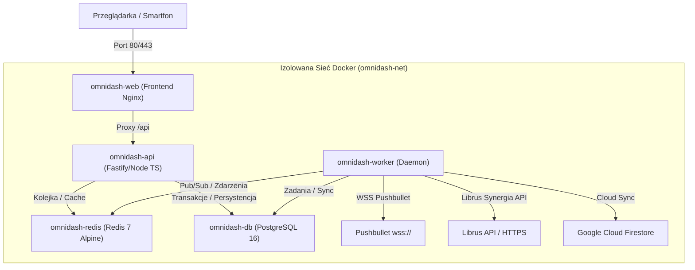

# 03. DOKERYZACJA I ARCHITEKTURA INFRASTRUKTURY
> Projekt: OmniDash Reborn (v4.0.0)  
> Standard wykonania: Protokół Antigravity v4.0 (Deterministic Edition)  
> Narzędzie: Docker & Docker Compose z multi-stage builds i polityką Least Privilege  

---

## 1. STRATEGIA DOKERYZACJI I TOPOLOGIA USŁUG

Wersja v4.0.0 całkowicie eliminuje ręczne uruchamianie procesów na hoście. Całe środowisko zostaje zamknięte w izolowanych kontenerach zarządzanych przez `docker-compose.yml`:



### Specyfikacja Usług Kontenerowych:

| Nazwa Kontenera | Rola / Przeznaczenie | Port Zewnętrzny | Port Wewnętrzny | Wolumeny Trwałe |
|---|---|---|---|---|
| `omnidash-web` | Frontend SPA (React 19 / TS) serwowany przez zoptymalizowany Nginx | `3000:80` | `80` | Brak (statyczny obraz) |
| `omnidash-api` | Serwer HTTP & SSE API, silnik LLM, sandbox narzędzi | `5000:5000` | `5000` | `storage_data:/app/data` |
| `omnidash-worker` | Tło: Pushbullet listener, scheduler Librusa, sync Firestore | Brak | Brak | `storage_data:/app/data` |
| `omnidash-db` | Relacyjna baza danych PostgreSQL 16 (lub SQLite WAL) | Opcjonalnie `5432:5432` | `5432` | `db_data:/var/lib/postgresql/data` |
| `omnidash-redis` | Pamięć podręczna, bufor rate-limitera, szyna zdarzeń | Brak | `6379` | `redis_data:/data` |

---

## 2. MANIFEST ORKIESTRACJI: `docker-compose.yml`

Poniżej znajduje się kompletny, produkcyjny plik orkiestracji wielousługowej:

```yaml
version: '3.9'

networks:
  omnidash-net:
    driver: bridge

volumes:
  db_data:
    driver: local
  redis_data:
    driver: local
  storage_data:
    driver: local

services:
  # =========================================================================
  # 1. BAZA DANYCH (PostgreSQL 16)
  # =========================================================================
  omnidash-db:
    image: postgres:16-alpine
    container_name: omnidash-db
    restart: unless-stopped
    environment:
      POSTGRES_USER: ${DB_USER:-omnidash}
      POSTGRES_PASSWORD: ${DB_PASSWORD:-omnidash_secret_pass}
      POSTGRES_DB: ${DB_NAME:-omnidash_db}
    volumes:
      - db_data:/var/lib/postgresql/data
    networks:
      - omnidash-net
    healthcheck:
      test: ["CMD-SHELL", "pg_isready -U ${DB_USER:-omnidash} -d ${DB_NAME:-omnidash_db}"]
      interval: 5s
      timeout: 5s
      retries: 5

  # =========================================================================
  # 2. SZYNA PAMIĘCI I ZDARZEŃ (Redis 7)
  # =========================================================================
  omnidash-redis:
    image: redis:7-alpine
    container_name: omnidash-redis
    restart: unless-stopped
    command: redis-server --appendonly yes --requirepass ${REDIS_PASSWORD:-redis_secret_pass}
    volumes:
      - redis_data:/data
    networks:
      - omnidash-net
    healthcheck:
      test: ["CMD", "redis-cli", "-a", "${REDIS_PASSWORD:-redis_secret_pass}", "ping"]
      interval: 5s
      timeout: 3s
      retries: 5

  # =========================================================================
  # 3. GŁÓWNY SERWER API (Fastify / TypeScript)
  # =========================================================================
  omnidash-api:
    build:
      context: .
      dockerfile: apps/api/Dockerfile.api
    container_name: omnidash-api
    restart: unless-stopped
    environment:
      NODE_ENV: production
      PORT: 5000
      DATABASE_URL: postgresql://${DB_USER:-omnidash}:${DB_PASSWORD:-omnidash_secret_pass}@omnidash-db:5432/${DB_NAME:-omnidash_db}
      REDIS_URL: redis://:${REDIS_PASSWORD:-redis_secret_pass}@omnidash-redis:6379
      GROQ_API_KEY: ${GROQ_API_KEY}
      BRAVE_SEARCH_API_KEY: ${BRAVE_SEARCH_API_KEY}
      PUSHBULLET_API_KEY: ${PUSHBULLET_API_KEY}
      FISH_AUDIO_API_KEY: ${FISH_AUDIO_API_KEY}
      LIBRUS_LOGIN: ${LIBRUS_LOGIN}
      LIBRUS_PASSWORD: ${LIBRUS_PASSWORD}
      FIREBASE_PROJECT_ID: ${FIREBASE_PROJECT_ID}
    volumes:
      - storage_data:/app/data
    ports:
      - "5000:5000"
    networks:
      - omnidash-net
    depends_on:
      omnidash-db:
        condition: service_healthy
      omnidash-redis:
        condition: service_healthy
    healthcheck:
      test: ["CMD-SHELL", "wget --no-verbose --tries=1 --spider http://127.0.0.1:5000/api/system/metrics || exit 1"]
      interval: 10s
      timeout: 5s
      retries: 3

  # =========================================================================
  # 4. DAEMON WORKER (Zadania w tle, Pushbullet, Librus Sync)
  # =========================================================================
  omnidash-worker:
    build:
      context: .
      dockerfile: apps/worker/Dockerfile.worker
    container_name: omnidash-worker
    restart: unless-stopped
    environment:
      NODE_ENV: production
      DATABASE_URL: postgresql://${DB_USER:-omnidash}:${DB_PASSWORD:-omnidash_secret_pass}@omnidash-db:5432/${DB_NAME:-omnidash_db}
      REDIS_URL: redis://:${REDIS_PASSWORD:-redis_secret_pass}@omnidash-redis:6379
      PUSHBULLET_API_KEY: ${PUSHBULLET_API_KEY}
      LIBRUS_LOGIN: ${LIBRUS_LOGIN}
      LIBRUS_PASSWORD: ${LIBRUS_PASSWORD}
      FIREBASE_PROJECT_ID: ${FIREBASE_PROJECT_ID}
    volumes:
      - storage_data:/app/data
    networks:
      - omnidash-net
    depends_on:
      omnidash-db:
        condition: service_healthy
      omnidash-redis:
        condition: service_healthy

  # =========================================================================
  # 5. FRONTEND GUI (Nginx + React 19 / TypeScript)
  # =========================================================================
  omnidash-web:
    build:
      context: .
      dockerfile: apps/web/Dockerfile.web
    container_name: omnidash-web
    restart: unless-stopped
    ports:
      - "3000:80"
    networks:
      - omnidash-net
    depends_on:
      omnidash-api:
        condition: service_healthy
```

---

## 3. MULTI-STAGE DOCKERFILES DLA KOMPONENTÓW

Wszystkie obrazy są budowane wieloetapowo (Multi-Stage Build) na bazie `node:22-alpine`, co redukuje rozmiar obrazów z 1.2 GB do poniżej 90 MB oraz izoluje narzędzia budowania od środowiska produkcyjnego:

### `apps/api/Dockerfile.api`:
```dockerfile
# ETAP 1: Budowanie TypeScript
FROM node:22-alpine AS builder
WORKDIR /app
RUN npm install -g pnpm
COPY pnpm-lock.yaml pnpm-workspace.yaml package.json ./
COPY packages/ ./packages/
COPY apps/api/ ./apps/api/
RUN pnpm install --frozen-lockfile
RUN pnpm --filter @omnidash/contracts build
RUN pnpm --filter @omnidash/api build

# ETAP 2: Produkcyjny Runtime
FROM node:22-alpine AS runner
WORKDIR /app
ENV NODE_ENV=production
RUN addgroup -S appgroup && adduser -S appuser -G appgroup
COPY --from=builder /app/package.json ./
COPY --from=builder /app/pnpm-lock.yaml ./
COPY --from=builder /app/packages/contracts/dist ./packages/contracts/dist
COPY --from=builder /app/packages/contracts/package.json ./packages/contracts/package.json
COPY --from=builder /app/apps/api/dist ./apps/api/dist
COPY --from=builder /app/apps/api/package.json ./apps/api/package.json
RUN npm install -g pnpm && pnpm install --prod --frozen-lockfile
USER appuser
EXPOSE 5000
CMD ["node", "apps/api/dist/index.js"]
```

### `apps/web/Dockerfile.web`:
```dockerfile
# ETAP 1: Budowanie frontendu
FROM node:22-alpine AS builder
WORKDIR /app
RUN npm install -g pnpm
COPY pnpm-lock.yaml pnpm-workspace.yaml package.json ./
COPY packages/ ./packages/
COPY apps/web/ ./apps/web/
RUN pnpm install --frozen-lockfile
RUN pnpm --filter @omnidash/contracts build
RUN pnpm --filter @omnidash/web build

# ETAP 2: Nginx Static Server
FROM nginx:1.27-alpine AS runner
COPY apps/web/nginx.conf /etc/nginx/conf.d/default.conf
COPY --from=builder /app/apps/web/dist /usr/share/nginx/html
EXPOSE 80
CMD ["nginx", "-g", "daemon off;"]
```

---

## 4. BEZPIECZEŃSTWO KONTENERÓW I INTEGRACJA SIECIOWA

1. **Uruchamianie jako Nie-Root (`USER appuser`):** Żaden proces aplikacji Node.js nie posiada uprawnień `root` wewnątrz kontenera, co blokuje ataki typu Container Escape.
2. **Izolacja Bazy Danych i Redis:** Porty bazy danych (`5432`) i brokera Redis (`6379`) nie są wystawione na interfejs publiczny hoście (`0.0.0.0`), a komunikacja odbywa się wyłącznie wewnątrz wirtualnej sieci `omnidash-net`.
3. **Konfiguracja Nginx z Ochroną Nagłówków i Proxy do API:**
   - Zapytania do `/api/*` są automatycznie proxowane wewnątrz sieci Docker do `http://omnidash-api:5000/api/*`.
   - Zapewnia to całkowite wyeliminowanie problemów z CORS na poziomie przeglądarki klienta.
   - Włączona kompresja Gzip/Brotli dla zasobów statycznych.
