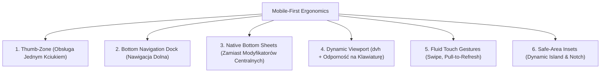

# 06. ARCHITEKTURA DEKOMPOZYCJI STRON I ERGONOMII MOBILNEJ
> Projekt: OmniDash Reborn (v4.0.0)  
> Cel: Eliminacja gigantycznych plików (>2000 linii), rygorystyczny podział na małe komponenty (≤150-250 linii) oraz najwyższej klasy wygoda obsługi na smartfonach wszelkich formatów.  
> Standard wykonania: Protokół Antigravity v4.0 (Deterministic Edition)  

---

## 1. DIAGNOZA ANOMALII KODU LEGACY (V3.4.0)

W toku audytu empirycznego zmierzono długość wszystkich plików stron i komponentów. Wykryto drastyczne naruszenie Zasady Pojedynczej Odpowiedzialności (Single Responsibility Principle):

```
[RANKING NAJWIĘKSZYCH MONOLITÓW KODU W V3.4.0]
├── clientAiDispatcher.js  ─── 2804 linie  [KRYTYCZNY] (Logika agenta, promptów i cache w przeglądarce)
├── librusService.js       ─── 2242 linie  [KRYTYCZNY] (Scraper, auth, oceny, plan, terminarz w jednym)
├── TimetablePage.jsx      ─── 2053 linie  [KRYTYCZNY] (Monolit planu lekcji: stan, modale, kalkulacje, widoki)
├── SettingsPage.jsx       ─── 1671 linii  [KRYTYCZNY] (Formularze, motywy, logi, konfiguracja API)
├── GradesPage.jsx         ─── 1659 linii  [KRYTYCZNY] (Średnie, wagi, tabela, kafelki, modale, sync)
├── ChatPage.jsx           ─── 1477 linii  [KRYTYCZNY] (Wątki, audio visualizer, szuflada narzędzi)
├── Dashboard.jsx          ─── 1417 linii  [KRYTYCZNY] (Siatka 10 widżetów, drawer zadań, modale OSINT)
├── Terminal.jsx           ─── 1300 linii  [KRYTYCZNY] (Czat, Markdown, speech synthesis, formularze)
├── WorkoutsPage.jsx       ─── 1051 linii  [KRYTYCZNY] (Rejestrator FBW, timery, schemat dnia)
├── FinancePage.jsx        ─── 1042 linii  [KRYTYCZNY] (Budżet 50/30/20, koperty, formularze, wykresy)
└── ttsService.js          ─── 1024 linie  [KRYTYCZNY] (5 silników mowy w jednym pliku)
```

### Dlaczego te giganty niszczą projekt?
1. **Uniemożliwiają Skalowanie i Ulepszenia:** Zmiana wyglądu jednego przycisku lub dodanie filtru wymaga modyfikacji 2000-liniowego pliku, co grozi przypadkowym uszkodzeniem niepowiązanej logiki (np. w `TimetablePage.jsx`).
2. **Wycieki Pamięci i Spadek FPS na Telefonach:** Re-render strony o wadze 1500 linii przy każdej zmianie stanu (np. wpisanie litery w formularzu) powoduje zacinanie interfejsu na procesorach mobilnych.
3. **Niemożność Pisania Czystych Testów:** Nie da się przetestować samego paska wyboru dnia lub pigułki oceny bez renderowania całej 2000-liniowej machiny.

---

## 2. STANDARD DEKOMPOZYCJI W V4.0.0 (RYGOR ≤150-250 LINII)

W nowej architekturze wprowadzamy twardy rygor architektoniczny:
- **Główna strona (`page.tsx`) to wyłącznie lekki koordynator layoutu (max 70-120 linii).** Nie zawiera logiki biznesowej, bezpośrednich zapytań `fetch` ani styli inline.
- **Logika stanu wyniesiona do dedykowanych hooków (`hooks/`) oraz magazynów Zustand (`stores/`).**
- **Wszystkie elementy wizualne podzielone na małe, atomowe komponenty (max 50-150 linii).**

### Matryca Dekompozycji dla Kluczowych Modułów:

#### A. Plan Dnia (`TimetablePage` — z 2053 linii do 9 mikro-komponentów):
```
apps/web/src/modules/timetable/
├── page.tsx                        ← 85 linii  (Koordynator układu i widoków)
├── hooks/
│   ├── useTimetableData.ts         ← 95 linii  (Pobieranie TanStack Query, buforowanie)
│   └── useLessonTracker.ts         ← 70 linii  (Zegar na żywo, odliczanie do dzwonka)
├── components/
│   ├── DaySelectorBar.tsx          ← 90 linii  (Pasek dni tygodnia z poziomym przewijaniem i gestami)
│   ├── LessonCard.tsx              ← 110 linii (Pojedyncza lekcja: czas, sala, nauczyciel, zastępstwo)
│   ├── CancellationBadge.tsx       ← 45 linii  (Pigułka odwołanej lekcji / okienka)
│   ├── CurrentLessonHero.tsx       ← 120 linii (Wyróżniona karta aktualnej lekcji na górze ekranu)
│   ├── LessonDetailsSheet.tsx      ← 130 linii (Wysuwany od dołu Bottom Sheet ze szczegółami)
│   └── PersonalRoutineModal.tsx    ← 115 linii (Formularz dodawania zadania osobistego)
└── utils/
    └── timetableMath.ts            ← 80 linii  (Czyste funkcje obliczania okienek i sortowania)
```

#### B. Dziennik Ocen (`GradesPage` — z 1659 linii do 8 mikro-komponentów):
```
apps/web/src/modules/grades/
├── page.tsx                        ← 75 linii  (Koordynator widoku semestrów i filtrów)
├── hooks/
│   └── useGradesData.ts            ← 90 linii  (Pobieranie ocen i wyzwalanie synchronizacji)
├── components/
│   ├── SemesterSegmentedBar.tsx    ← 60 linii  (Przełącznik Semestr 1 / Semestr 2)
│   ├── GradeStatsSummary.tsx       ← 95 linii  (Karta średniej ogólnej 4.62 i szczęśliwego numerka)
│   ├── SubjectGradesGrid.tsx       ← 110 linii (Siatka przedmiotów — responsywna 1/2/3 kolumny)
│   ├── GradePill.tsx               ← 50 linii  (Pigułka oceny z wagą, modyfikatorem +/-)
│   ├── GradeDetailsSheet.tsx       ← 120 linii (Bottom Sheet z pełną historią ocen z przedmiotu)
│   └── LibrusSyncProgress.tsx      ← 65 linii  (Animowany pasek postępu synchronizacji ze szkołą)
└── utils/
    └── gradeCalculations.ts        ← 75 linii  (Ważone średnie z Golden Dataset)
```

#### C. Terminal AI i Czat (`ChatPage` & `Terminal` — z 2777 linii do 8 mikro-komponentów):
```
apps/web/src/modules/chat/
├── page.tsx                        ← 90 linii  (Główny ekran rozmowy i trybu Mentor/Worker)
├── hooks/
│   ├── useChatStream.ts            ← 130 linii (Obsługa strumienia SSE i parsowania tokenów)
│   └── useSpeechRecognition.ts     ← 85 linii  (Nagrywanie mikrofonu i Whisper STT)
├── components/
│   ├── ChatMessageList.tsx         ← 105 linii (Wirtualizowana lista wiadomości z auto-scroll)
│   ├── ChatMessageItem.tsx         ← 135 linii (Dymek wiadomości z formatowaniem Markdown/tabele)
│   ├── ChatInputBar.tsx            ← 125 linii (Elastyczne pole tekstowe + przycisk audio + wysyłka)
│   ├── ToolCallingAccordion.tsx    ← 95 linii  (Animowana kapsuła wykonywanych narzędzi AI)
│   ├── VoiceInspectorHUD.tsx       ← 90 linii  (Pływający wizualizator fali dźwiękowej)
│   └── HarveySalesDrawer.tsx       ← 140 linii (Szuflada prospektingowa B2B Harveya)
└── stores/
    └── chatStore.ts                ← 80 linii  (Magazyn stanu sesji w Zustand)
```

#### D. Pulpit Operacyjny (`Dashboard` — z 1417 linii do widżetów modułowych):
```
apps/web/src/modules/dashboard/
├── page.tsx                        ← 80 linii  (Siatka siatkowa widgetów i gest pull-to-refresh)
├── components/
│   ├── WeatherTrafficCapsule.tsx   ← 110 linii (Pogoda na żywo + radar CANARD i alerty GDDKiA)
│   ├── SystemTelemetryWidget.tsx   ← 95 linii  (Puls telemetrii CPU/RAM/Uptime z SSE)
│   ├── ExecutiveTodoWidget.tsx     ← 100 linii (Podgląd 2 najbliższych zadań + ring postępu)
│   ├── QuickActionsBar.tsx         ← 85 linii  (Szybkie akcje 1-kliknięciem)
│   ├── ITNewsTickerBar.tsx         ← 90 linii  (Przewijany pasek najświeższych newsów)
│   └── TodoSlideOverDrawer.tsx     ← 135 linii (Pełny arkusz listy zadań z filtrowaniem)
```

---

## 3. ERGONOMIA MOBILNA: MAKSYMALNA WYGODA NA KAŻDYM SMARTFONIE

Aby OmniDash działał na smartfonie jak natywna aplikacja iOS/Android (płynnie, intuicyjnie i bez frustracji), wdrażamy 6 filarów ergonomii mobilnej:



### Filar 1: Architektura Strefy Kciuka (Natural Thumb-Zone)
- Badania ergonomiczne wykazują, że 75% użytkowników obsługuje telefon jedną ręką za pomocą kciuka.
- W kodzie Legacy kluczowe przyciski (np. nawigacja, zamknięcie modali `X`, filtry) znajdowały się w lewym lub prawym górnym rogu ekranu — strefie fizycznie niedostępnej bez użycia drugiej ręki na ekranach >6.1".
- **W v4.0.0:** Wszystkie kluczowe punkty interakcji (nawigacja, zatwierdzanie, pole czatu, filtry dni, dodawanie zadań) znajdują się w **dolnych 45% wysokości ekranu**.

### Filar 2: Dolny Dok Nawigacyjny (Bottom Tab Bar)
- Zastępuje górne menu hamburgerowe na urządzeniach mobilnych:
  - 4 główne destynacje: **Pulpit**, **Czat AI**, **Plan Dnia**, **Oceny** + ikona **Więcej** (otwierająca arkusz z Finansami, Treningiem, OSINT-em i Ustawieniami).
  - Pasek posiada rozmyte tło Apple Glass (`backdrop-blur-xl bg-black/40 border-t border-white/10`).
  - Rozmiar każdego przycisku dotykowego: **min. 48px × 48px** z haptycznym potwierdzeniem tapnięcia.
  - Automatyczne uwzględnienie dolnego paska domowego iOS: `padding-bottom: max(0.75rem, env(safe-area-inset-bottom))`.

### Filar 3: Natywne Arkusze Dolne (Bottom Sheets zamiast Centralnych Modali)
- W wersji Legacy centralne okna modalne (`fixed inset-0 flex items-center justify-center`) były nieintuicyjne na telefonach i zasłaniały cały ekran.
- **W v4.0.0:** Na ekranach `< 768px` każdy modal (np. edycja zadania, szczegóły oceny z Librusa, podgląd artykułu OSINT) staje się płynnym **arkuszem dolnym (Bottom Sheet)**:
  - Posiada widoczny uchwyt przeciągania (Drag Handle Pill na samej górze).
  - Obsługuje gest **przesunięcia w dół (Swipe Down to Dismiss)** z fizyką sprężynową Framer Motion.
  - Użytkownik zamyka arkusz naturalnym ruchem kciuka w dół bez szukania przycisku `X`.

### Filar 4: Dynamic Viewport Units (`dvh`) i Odporność na Klawiatury
- **Problem Legacy:** Użycie klasycznego `100vh` powodowało, że dolne paski przeglądarek (Safari na iOS, Chrome na Androidzie) oraz wirtualna klawiatura obcinały pole wprowadzania tekstu w czacie.
- **Rozwiązanie v4.0.0:**
  - Zastosowanie jednostki `100dvh` (Dynamic Viewport Height) oraz `100svh`.
  - Integracja z API `window.visualViewport`: przy wysunięciu klawiatury kontener czatu natychmiast dopasowuje swoją wysokość, a pole tekstowe płynnie unosi się tuż nad klawiaturą, zapobiegając uciekaniu tekstu poza kadr.

### Filar 5: Likwidacja Scroll-Jackingu i Płynne Gesty Dotykowe
- Zlikwidowano zagnieżdżone paski przewijania (`nested overflow-y-scroll`), które na Androidzie blokowały naturalne przewijanie strony.
- Wdrożono:
  - **Swipe poziomy na Planie Dnia:** Przesunięcie palcem w lewo/prawo płynnie przełącza dzień tygodnia (poniedziałek <-> wtorek).
  - **Pull-to-Refresh:** Pociągnięcie ekranu Pulpitu lub Ocen w dół z oporem sprężynowym wyzwala natychmiastowe odświeżenie danych z Librusa i pogody.
  - **Swipe-to-Action:** Przeciągnięcie zadania na liście w prawo oznacza je jako wykonane; przeciągnięcie w lewo wysuwa czerwoną akcję usunięcia.

### Filar 6: Pełne Wsparcie Safe-Area Insets (Notch, Dynamic Island, Foldables)
- Konfiguracja viewportu w meta tagu: `viewport-fit=cover`.
- Dedykowane klasy Tailwind utility:
  - Górny nagłówek: `pt-[max(1rem,env(safe-area-inset-top))]` (chroni przed wcięciem na aparat).
  - Dolny pasek nawigacyjny: `pb-[max(0.75rem,env(safe-area-inset-bottom))]`.
  - Boki ekranu w trybie horyzontalnym (np. tablety / telefony poziomo): `pl-[env(safe-area-inset-left)]` oraz `pr-[env(safe-area-inset-right)]`.
