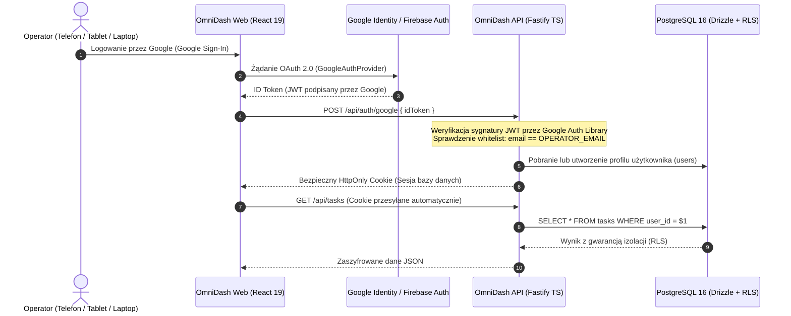

# OMNIDASH REBORN (v4.0.0) — AUDYT BEZPIECZEŃSTWA I WZMACNIANIE KODU (HARDENING)
> Opracowano na podstawie audytu kodu v3.4.0, uwag korepetytora oraz kompendium inżynieryjnego Kvbi213  
> Data: 2026-10-30 | Status: SPEC_APPROVED | Standard: Zero-Trust & OWASP Top 10 (2026)  

---

## 1. ZIDENTYFIKOWANE LUKI BEZPIECZEŃSTWA W WERSJI LEGACY (v3.4.0)

W toku audytu empirycznego potwierdzono krytyczne uwagi dotyczące stosowania wieloznaczników gwiazdki (`*`) oraz luźnych reguł dostępu:

### Luka 1: Dzikie Gwiazdki CORS (`Access-Control-Allow-Origin: *`)
- **Lokalizacja:** `api/agent.js`, `api/librus.js`, `api/entities.js`, `api/news.js`, `api/osint.js`, `api/tts.js`, `api/phone.js`, `api/pushbullet-webhook.js`.
- **Kod w Legacy:**
  ```javascript
  res.setHeader('Access-Control-Allow-Credentials', 'true');
  res.setHeader('Access-Control-Allow-Origin', '*');
  ```
- **Wektor Zagrożenia:** Każda obca strona WWW otwarta w przeglądarce operatora mogła wysyłać zapytania do endpointów API (w tym odczytywać oceny z Librusa, historię czatu AI i wyzwalać syntezę mowy). Połączenie `Allow-Credentials: true` z `Origin: *` stanowi rażące naruszenie standardów W3C/Fetch Spec.
- **Eliminacja w v4.0.0:** Ścisła biała lista zaufanych domen (Trusted Origins) weryfikowana po stronie serwera Fastify/Express. Żadne zapytanie z obcej domeny nie otrzyma nagłówka zezwalającego.

### Luka 2: Brak Izolacji Danych w Regułach Firestore (Brak Sprawdzania Właściciela)
- **Lokalizacja:** `firestore.rules` linie 38-40:
  ```javascript
  match /{collection}/{docId} {
    allow read, write: if isAllowedCollection(collection) && isAuthenticated();
  }
  ```
- **Wektor Zagrożenia:** Każdy zalogowany użytkownik (w tym konto anonimowe lub dowolne inne konto Google) posiadał pełne uprawnienia do odczytu i nadpisywania cudzych zadań, finansów, notatek, planu dnia i bazy wiedzy. Brak relacji `request.auth.uid == resource.data.userId`.
- **Eliminacja w v4.0.0:** 
  1. Przejście na relacyjną bazę PostgreSQL z Row-Level Security (RLS) lub ścisłą warstwę repozytoriów Drizzle ORM, gdzie każde zapytanie wymusza `WHERE user_id = $1`.
  2. W regułach Firestore: wymóg jawnego sprawdzania tożsamości właściciela: `allow read, write: if isAuthenticated() && request.auth.uid == resource.data.userId;`.

### Luka 3: Przesyłanie Poświadczeń Librusa w Nagłówkach HTTP Bez Szyfrowania
- **Lokalizacja:** `api/librus.js` linie 20-21 (`req.headers['x-librus-login']`, `req.headers['x-librus-password']`).
- **Wektor Zagrożenia:** Wystawienie poświadczeń konta szkolnego w nagłówkach zapytań przeglądarki.
- **Eliminacja w v4.0.0:** Poświadczenia Librus Synergia przechowywane wyłącznie w zaszyfrowanym magazynie backendu (AES-256-GCM) lub w zmiennych środowiskowych serwera. Klient frontendowy nigdy nie przesyła haseł w nagłówkach zapytań roboczych.

### Luka 4: Brak Rate Limitingu na Wrażliwych Endpointach AI i Auth
- **Lokalizacja:** Brak ograniczników w bezstanowych funkcjach Vercel `/api/agent`, `/api/tts`.
- **Wektor Zagrożenia:** Ryzyko wyczerpania limitu tokenów Groq API, ElevenLabs lub Fish Audio przez automatyczne pętle lub ataki Denial of Wallet (wyczerpanie budżetu chmurowego).
- **Eliminacja w v4.0.0:** Rate Limiter w kontenerze API oparty o pamięć Redis (`@fastify/rate-limit` lub `express-rate-limit` z `redisStore`): max 20 zapytań AI na minutę per autoryzowany użytkownik.

---

## 2. ARCHITEKTURA AUTORYZACJI Z WYKORZYSTANIEM GOOGLE CLOUD AUTH

Zgodnie z dyrektywą operatora zachowujemy i wzmacniamy integrację z Google Cloud Identity / Firebase Auth:



### Reguły Twarde Bezpieczeństwa Tożsamości:
1. **Google ID Token Verification:** Backend weryfikuje token Google za pomocą oficjalnej biblioteki `google-auth-library` (`oauth2Client.verifyIdToken`), sprawdzając `audience`, `issuer` oraz pole `email_verified: true`.
2. **Kwalifikacja Właściciela (Single-Owner / Whitelist RBAC):**
   - Jeśli e-mail zgadza się z adresem operatora (`OPERATOR_EMAIL`), przyznawana jest rola `ADMIN`.
   - Pozostałe nieautoryzowane konta otrzymują natychmiastowy kod `403 Forbidden` z blokadą sesji.
3. **Brak Przechowywania Kluczy w LocalStorage:** Przejście z `localStorage` na bezpieczne ciasteczka `HttpOnly`, `SameSite: Strict`, `Secure`, uniemożliwiające kradzież sesji przez skrypty XSS.

---

## 3. ARCHITEKTURA RESPANSYWNA MULTI-DEVICE (TELEFON / TABLET / DESKTOP)

Nowy interfejs budowany jest od zera z rygorystycznym uwzględnieniem specyfiki ekranów dotykowych i desktopowych:

```
[EKOSYSTEM WIDOKÓW OMNIDASH]
├── SMARTFON (Pion / 375px - 430px)
│   ├── Bottom Navigation Bar (Dock iOS z ikonami: Pulpit, Chat, Plan, Oceny, Więcej)
│   ├── Apple Slide-Over Drawers (Zadania, Szybki podgląd, Pogoda) wysuwane gestem od dołu (Bottom Sheet)
│   ├── Obsługa safe-area insets: pt-safe, pb-safe (Dynamic Island i dolny pasek domowy)
│   └── Minimalny rozmiar elementów dotykowych: 44px × 44px
│
├── TABLET (iPad / Tablet 768px - 1024px)
│   ├── Zwinięty pasek boczny (Sidebar w trybie ikon) lub układ 2-kolumnowy (Master-Detail)
│   ├── Podział widoku w module Chat: lewa lista wątków + prawa konsola rozmowy
│   └── Siatka widżetów Pulpitu w układzie 2 kolumn
│
└── LAPTOP / DESKTOP (1280px+)
    ├── Pełny pasek boczny (Sidebar) z możliwością zwijania do trybu mini
    ├── Siatka widżetów Pulpitu w układzie 3-4 kolumn
    ├── Pływająca konsola Command Palette (Ctrl+K / Cmd+K)
    └── Slide-Over Drawer wysuwany z prawej krawędzi ekranu
```

---

## 4. WZMACNIANIE SIECIOWE I VPS MIKR.US / CLOUDFLARE

Zgodnie z dostarczonym kompendium inżynierskim, backend i kontenery są przygotowane do bezkolizyjnego hostowania na VPS Mikr.us (kontenery LXC, sieć IPv6-mostly) oraz za proxy Cloudflare:

1. **Odzyskiwanie Prawdziwego IP Klienta (`ngx_http_realip_module`):**
   - Nginx w kontenerze `omnidash-web` posiada wstrzyknięte zaufane pule adresowe Cloudflare oraz proxy Mikrusa.
   - Dyrektywy `real_ip_header X-Forwarded-For;` oraz `real_ip_recursive on;` zapobiegają blokowaniu całego serwera proxy przez Rate Limiter.
2. **Bindowanie IPv6 w Node.js:**
   - Wszystkie usługi serwerowe (`apps/api`) nasłuchują na adresie `::` (IPv6 oraz IPv4 dual-stack via `0.0.0.0` / `[::]`), co pozwala na bezpośrednią współpracę z darmowymi subdomenami `mikrus.cloud` oraz rekordami AAAA w Cloudflare.
3. **Ochrona Przed Slopsquattingiem:**
   - W procesie instalacji pakietów (`pnpm install --frozen-lockfile`) weryfikowany jest wiek paczek, liczba pobrań oraz zgodność z `pnpm-lock.yaml`. Zakaz instalacji niezweryfikowanych bibliotek z promptów AI.
